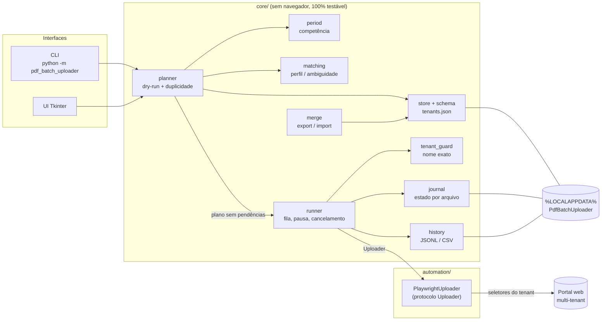
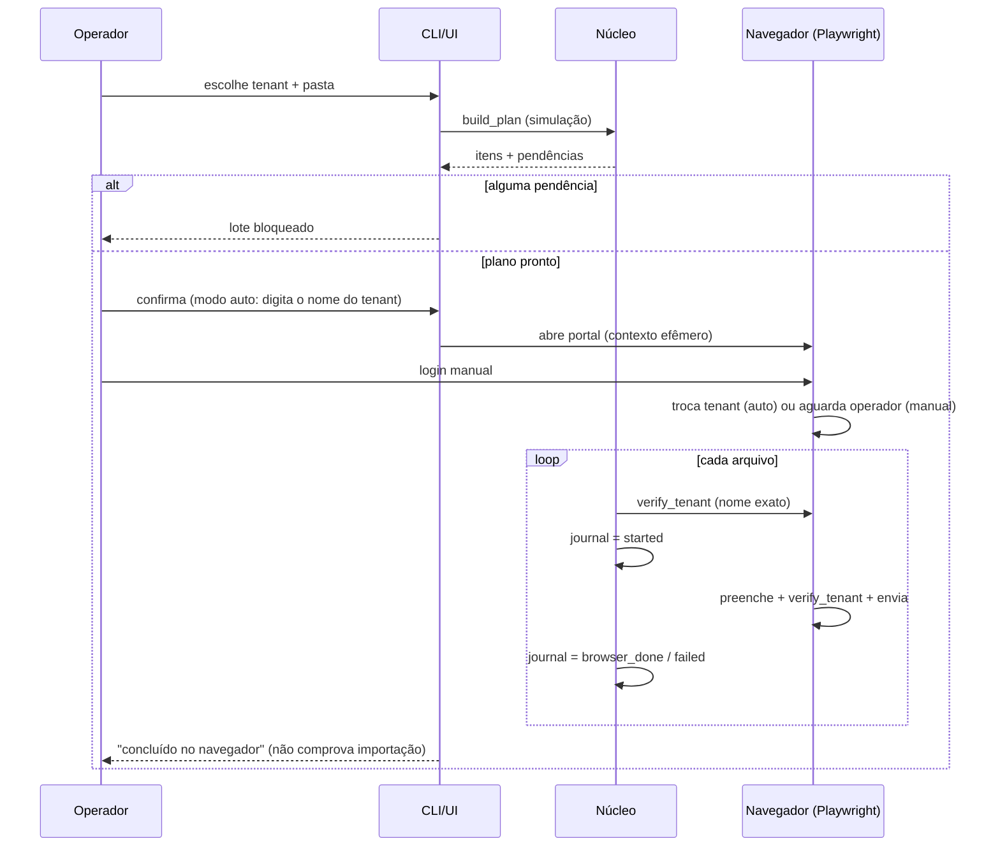

# pdf-batch-uploader

Uploader em lote de documentos PDF para **portais web multi-tenant**, via Playwright, com **perfis por tenant**, simulação obrigatória e **validação do tenant ativo antes de cada envio**.

> Este repositório é uma **versão de referência genérica** de uma ferramenta interna. Não contém nomes de sistemas, clientes, URLs, seletores nem fluxos reais de tela. Tudo é demonstrado contra um **portal de demonstração local** incluído (`demo_portal/`).

## O problema

Muitos portais SaaS B2B atendem vários clientes (*tenants*) na mesma conta de operador. Importar documentos mensais (holerites, relatórios, comprovantes) costuma ser assim:

1. trocar o tenant ativo no portal;
2. abrir a tela de envio;
3. para cada PDF, escolher arquivo, competência (mês de referência) e 3 a 5 campos de classificação;
4. repetir para dezenas de arquivos e vários tenants.

Além de lento, o processo manual tem um risco crítico: **enviar o documento ao tenant errado**, porque o seletor de tenant ficou no cliente anterior ou porque dois tenants têm nomes parecidos ("EMPRESA ALFA LTDA" x "EMPRESA ALFA LTDA FILIAL NORTE"). Em documentos com dados pessoais, isso é um incidente de privacidade (LGPD).

## O que a ferramenta faz

| Funcionalidade | Como |
| --- | --- |
| Cadastro de tenants e perfis | JSON validado por **JSON Schema** fechado (`core/schema.py`), com escrita atômica e backup automático |
| Competência pelo nome do arquivo | `2026-09`, `09-2026`, `202609`, 13º (`13o`, `13º`, `2025-13`, `decimo terceiro`…) — `core/period.py` |
| Sugestão de perfil | palavras-chave + exclusões + separação 13º/mensal; **empate = ambíguo**, nunca "melhor palpite" — `core/matching.py` |
| Simulação (dry-run) | lista arquivo, competência, perfil, hash e pendências sem abrir navegador — `core/planner.py` |
| Fila com pausar/cancelar | só **entre** arquivos; um envio em andamento nunca é cortado — `core/runner.py` |
| Validação de tenant | lê o tenant ativo na página e compara **exatamente** com o esperado antes de cada arquivo e antes do clique final — `core/tenant_guard.py` |
| Duplicidade por hash | SHA-256 do arquivo; renomear não engana; aviso se o mesmo arquivo já foi a **outro** tenant |
| Histórico local | JSONL append-only + exportação CSV com proteção contra injeção de fórmula — `core/history.py` |
| Recuperação | retoma **somente pendentes** íntegros (mesmo hash, mesmo perfil); itens incertos vão para conferência — `core/journal.py` |
| Export/import de perfis | merge sem sobrescrever, com relatório de conflitos — `core/merge.py` |
| Automação | Playwright com **seletores configuráveis por tenant** — `automation/playwright_uploader.py` |
| Interfaces | CLI (`python -m pdf_batch_uploader`) e UI Tkinter mínima (`ui/app.py`), ambas sobre o mesmo núcleo |

## Arquitetura



Fluxo de um lote:



O `BatchRunner` só conhece o protocolo `Uploader` (`prepare`, `verify_tenant`, `upload`). Os testes do núcleo usam um uploader falso; a automação real é uma implementação trocável.

## Segurança e LGPD

- **Sem conteúdo de documento em log.** O PDF é lido apenas para calcular o SHA-256 e conferir a assinatura `%PDF-`. Nada é extraído ou registrado.
- **Redação de dados pessoais.** Nome de arquivo e mensagens passam por `core/text.redact` antes do histórico (CPF, CNPJ, e-mail, sequências numéricas longas). A simulação avisa quando o nome do arquivo parece conter dado pessoal.
- **Nenhuma credencial salva.** O cadastro não tem campo de senha/token e o schema recusa chaves com esses nomes. O login é **sempre manual** pelo operador, num contexto de navegador **efêmero** (sem perfil persistente, cookies descartados ao fechar).
- **Dados locais fora do repositório:** `%LOCALAPPDATA%\PdfBatchUploader` (Windows) ou `~/.local/share/pdf-batch-uploader`. O `.gitignore` bloqueia PDFs, CSV, JSONL e cadastros.
- **Validação do tenant em camadas:** antes do lote, antes de cada arquivo e imediatamente antes do clique de envio. Comparação exata (sem prefixo/"contém"); no modo automático, a troca exige **uma única** opção com rótulo exato.
- **Confirmação explícita no modo automático:** o operador digita o nome do tenant (CLI e UI).
- **Duplicidade por hash:** bloqueia reenvio do mesmo conteúdo ao mesmo tenant (inclusive itens de resultado incerto) e avisa se já foi enviado a outro.
- **Estados honestos:** `browser_done` significa *"o fluxo no navegador terminou"*. **Conclusão no navegador não comprova importação** — o processamento no portal pode falhar depois. Confira o status final no próprio portal.
- **Recuperação conservadora:** só `pending` é retomado; `started`/`failed` exigem conferência humana. Arquivo alterado (hash) ou perfil alterado bloqueia a retomada.
- **Cadastro como entrada não confiável:** schema fechado, limites de tamanho, valores só texto, HTTPS obrigatório (HTTP apenas para localhost). Import faz merge, nunca sobrescreve, e gera backup.
- **CSV seguro:** células iniciadas por `= + - @` são neutralizadas ao exportar.

## Como rodar o demo

Requisitos: Python 3.10+ (testado com 3.13) no Windows, Linux ou macOS.

```bash
python -m venv .venv
# Windows: .venv\Scripts\activate   |   Linux/macOS: source .venv/bin/activate
pip install -r requirements-dev.txt
python -m playwright install chromium
```

1. Suba o portal de demonstração (apenas arquivos estáticos, nada sai da máquina):

   ```bash
   python -m http.server 8765 --bind 127.0.0.1 --directory demo_portal
   ```

2. Em outro terminal, importe os tenants fictícios e gere PDFs de exemplo:

   ```bash
   python -m pdf_batch_uploader demo-setup --samples ./amostras
   python -m pdf_batch_uploader tenants list
   ```

3. Simule — as amostras incluem, de propósito, um arquivo ambíguo e um sem competência:

   ```bash
   python -m pdf_batch_uploader simulate --tenant alfa --dir ./amostras
   ```

4. Resolva as pendências por arquivo e execute no modo automático (abre o Chromium; clique em **Entrar (demo)** para simular o login manual):

   ```bash
   python -m pdf_batch_uploader run --tenant alfa --dir ./amostras --mode auto \
       --profile "ferias_mensal_2026-08.pdf=Ferias" \
       --period "documento_sem_competencia.pdf=2026-06" \
       --profile "documento_sem_competencia.pdf=Mensal - Ativos"
   ```

   O portal começa no tenant `EMPRESA BETA S.A.`; a ferramenta troca para `EMPRESA ALFA LTDA`, confere e envia. Rode o mesmo comando de novo: o lote é bloqueado por duplicidade de hash.

5. Outros comandos:

   ```bash
   python -m pdf_batch_uploader recover --tenant alfa            # lista lotes
   python -m pdf_batch_uploader recover --tenant alfa --batch <id> --run
   python -m pdf_batch_uploader history --export-csv historico.csv
   python -m pdf_batch_uploader profiles export --tenant alfa --out alfa.json
   python -m pdf_batch_uploader profiles import alfa.json --dry-run
   python -m pdf_batch_uploader ui                               # interface Tkinter
   ```

Use `--data-dir <pasta>` (ou `PBU_DATA_DIR`) para isolar os dados do demo.

### Configurando um portal real

Cada tenant declara a URL e os seletores CSS da página (`portal.selectors`) e cada perfil declara os valores dos campos (`fields`), que precisam ter um seletor correspondente em `selectors.fields`. Veja `examples/tenants.demo.json`. Valide antes de usar:

```bash
python -m pdf_batch_uploader tenants validate --file meu-cadastro.json
```

## Testes

```bash
pytest -m "not e2e"   # núcleo: competência, perfis/ambiguidade, schema, merge, fila, recuperação, histórico, CLI
pytest -m e2e         # Playwright + Chromium contra o portal demo (o próprio teste sobe o portal local)
```

Os testes e2e cobrem: troca automática de tenant, nomes de tenant parecidos, tenant trocado **no meio** do lote (aborta e mantém pendentes) e modo manual com tenant errado (nada é enviado). São ignorados se o Chromium não estiver instalado.

## Empacotamento (Windows)

```powershell
powershell -ExecutionPolicy Bypass -File .\scripts\build_exe.ps1                 # sem Chromium embutido
powershell -ExecutionPolicy Bypass -File .\scripts\build_exe.ps1 -BundleChromium # inclui o Chromium
```

Gera `dist\PdfBatchUploader\PdfBatchUploader.exe` (UI). Nenhum dado de usuário é empacotado.

## Limitações

- O portal demo é deliberadamente simples (uma página, sem SPA, sem rede). Portais reais exigem ajustar seletores, esperas e, às vezes, a navegação até a tela de envio.
- A "confirmação" do envio é a mensagem de sucesso na página; **não** há integração com API do portal para confirmar o processamento.
- Sem paralelismo: um arquivo por vez, de propósito (rastreabilidade e validação de tenant por item).
- A redação de dados pessoais é por padrões (regex) e não substitui uma política de nomes de arquivo sem dados pessoais.
- A convenção do 13º sem mês explícito (`AAAA-12`) é uma escolha do demo; ajuste ao seu portal.
- A UI Tkinter é mínima (sem edição de perfis; o cadastro é editado em JSON e validado pela CLI).

## Licença

MIT — veja [LICENSE](LICENSE).
